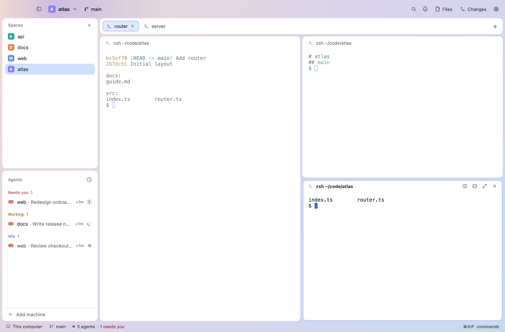

# Merdr

An Islands-style layout for [Herdr](https://herdr.dev), after the JetBrains
theme: solid islands floating on frosted glass, with its own light and dark
colors.



## What you get

- **Frosted glass.** The toolbar, the status bar and the gaps between islands
  show what is behind the window, blurred. The islands stay solid, so text keeps
  its contrast.
- **A toolbar** with the space and its branch, washed in the space's color:
  sidebar button, search, notifications, Files, Changes and Settings.
- **Islands.** Spaces, Agents, the tab bar and every terminal pane are rounded
  islands of their own.
- **Focus follows the mouse.** Move into another pane and it takes the keyboard.
  The focused pane has a soft blue edge; in a split tab the others fade.
- **Calm motion.** Selections slide instead of jumping, and `cmd-b` slides the
  sidebar out and back.
- **Notifications.** A note in the corner when an agent finishes or needs you,
  kept in a list behind the bell.
- **Light and dark** follow the system.

Spaces, agents, tabs, split panes, the Files and Changes panels and the status
bar work as they do in Herdr.

## Requirements

- macOS
- Herdr 0.1.18 or newer

## Install

Ask your agent in Herdr:

> Add this Herdr layout: https://github.com/melik-droid/Merdr

Or install it yourself:

```sh
git clone https://github.com/melik-droid/Merdr
sh Merdr/install.sh
```

The script:

- copies the layout, its mods and the two themes into `~/.config/herdr-app`
- adds `cmd-b` for the sliding sidebar to your `keys.json` (backed up first)
- checks the mods and switches to Merdr

It never overwrites a layout, mod or theme of yours with the same name.
`ctrl-shift-l` switches back to your previous layout.

| Option | Effect |
|---|---|
| `--home DIR` | install into another Herdr app home |
| `--no-check` | skip the version check and `herdr-app check` |
| `--no-switch` | install without switching to Merdr |

## Update

```sh
git -C Merdr pull
sh Merdr/install.sh
```

An update replaces the files Merdr installed, including any edits you made to
them.

## Uninstall

```sh
sh Merdr/uninstall.sh
```

Removes only what the installer added and switches back to Herdr's main layout.

## Coming from Islet

Merdr was published as Islet before. Run `sh uninstall.sh` in your old Islet
folder, then install Merdr.

## Keys

| Key | Does |
|---|---|
| `cmd-b` | slide the sidebar out or back |

Everything else is your own `keys.json`. In Herdr's defaults `cmd-w` closes the
whole tab and `cmd-shift-w` closes one pane.

## Make it yours

The look lives in a few files under `~/.config/herdr-app`. To keep your changes
across updates, copy the layout or theme under a new name and edit the copy.

| What | Where |
|---|---|
| How see-through the glass is | `colors.canvas` in `themes/merdr-light.json` and `merdr-dark.json`: the last two hex digits are the opacity (`b3` is 70%, `c2` is 76%) |
| How much unfocused panes fade | `veil` in `layouts/merdr.json` (0 turns it off) |
| The focused pane's edge | `focus.color` in `layouts/merdr.json` |
| Colors | the two theme files |

Keep `colors.background` fully clear (it ends in `00`): Herdr paints it under
the whole window, and anything else hides the glass.

## Good to know

- With a menu or the command palette open, typing stays there, but moving the
  mouse over another pane behind it still moves the focus. Pane commands act on
  the focused pane.
- The Spaces list is Herdr's own, so like Herdr's it runs `git` for branch names
  and `hc` for the machine list. Merdr adds no programs of its own.
- Choosing another theme in Herdr's theme picker replaces Merdr's colors until
  you pick `merdr-light` / `merdr-dark` again.
- [RECIPE.md](RECIPE.md) describes how the layout is built, for people and
  agents.

Merdr is not affiliated with Herdr or JetBrains.

## License

MIT
