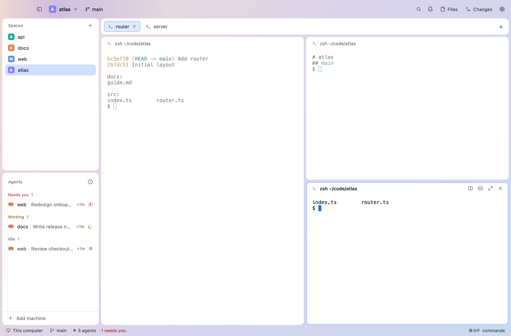

# Merdr

An Islands-style Herdr window (after the JetBrains theme) on frosted glass.
Solid islands float on a translucent, blurred ground; the tab bar and each pane are
islands of their own; selections are tinted blue and slide instead of jumping.
Spaces, agents, tabs, split panes, Files and Changes panels and the status bar
are Herdr's own.

## What you see

Top to bottom, no outline around any island:

- **Toolbar, 50px**, window-draggable, on the ground: macOS window buttons
  (`traffic_lights: [20, 16]`), sidebar button, space chip (avatar, name, opens
  the picker), branch; on the right search, bell, Files, Changes, Settings. The
  space's avatar color washes the ground from the left edge: strongest 150px in
  (30% light, 42% dark), gone at 460px.
- **Body**, 6px side padding, 6px between islands:
  - **Sidebar, 262px** (resizing off, min 0, max 480): the **Spaces** island,
    then the **Agents** island over a 37px "Add machine" footer. 10px corners.
  - **Tab bar island** (`tabs`, 44px, `surface`, 10px corners): tabs and `+`.
  - **Pane islands**, 6px below it and 6px apart: every pane, also a lone one,
    has 10px corners and `surface` fill. The frame's edge is 3px: `surface` (so
    unseen) on the others, a soft blue (`#538af966`) on the focused pane. A 30px header: program icon (13px, accent when
    focused), title in 12.5px (semibold and full strength when focused, `dim`
    otherwise), status mark, and split right / split down / zoom / close on the
    focused or hovered pane. In a split tab the other panes fade (pane frame
    `veil` 0.45).
  - The Files / Changes panel (368px, hidden at start) opens as its own island.
- **Status bar, 30px**, on the ground: machine, branch, agent count, commands hint.
- Fonts: Menlo for terminals, the system UI font for everything else.
  Terminal padding 14px × 12px.

Colors come from the two theme files (`merdr-light`, `merdr-dark`), picked by
the system appearance. Only `canvas` (the ground) is translucent;
the root's `window_blur` blurs what shows through:

| | light | dark |
|---|---|---|
| ground (`canvas`) | `#e8eaf0b3` | `#222328c2` |
| sidebar islands (`chrome`, solid) | `#ffffff` | `#18191b` |
| tab bar, pane and panel islands (`surface`, solid) | `#ffffff` | `#18191b` |
| window base (`colors.background`, clear) | `#ffffff00` | `#18191b00` |
| text / muted / dim | `#16171b` / `#42444e` / `#5c5f68` | `#e6e8ec` / `#c0c3ca` / `#9fa2a8` |
| `accent` | `#2f6fe4` | `#538af9` |
| selected row / hover | `#d0dffe` / `#eef0f4` | `#2a4371` / `#26282d` |
| done / working / blocked | `#1f6b3f` / `#835200` / `#b02a37` | `#7cc088` / `#e0a84a` / `#f8878d` |

Text, muted, dim and status colors keep at least 4.5:1 on the island and the
ground. The 16 terminal colors are in the theme files as well.

## How it behaves

- **Agent status**: working shows a spinning mark, blocked (needs you) red,
  done green, idle a hollow ring; the same marks show in the Agents list, the
  tab and the pane header.
- **Sliding selection**: in Spaces and Agents one selection background springs
  to the selected row (spring response 220ms, damping 0.9); in the tab bar the
  active tab's tinted background springs to its place and width the same way.
  Hover backgrounds fade in and out over 120ms.
- **Focus follows the pointer**: moving the mouse into another pane of the shown
  tab focuses it after 100 ms. Nothing happens while a button is held, and a
  keyboard focus change stays put until the pointer enters a different pane.
  Each pane header watches the window's mouse moves and reports its own line in
  shared `merdr.pane.rects`; `paneUnder` (model.js) picks the pane. An open menu
  or dialog keeps the keyboard, but moving across the panes behind it still
  changes which one is focused.
- **New panes**: a pane's header fades in over 220ms when a pane appears.
- **Sidebar**: `cmd-b` (and the sidebar button) narrows the column from 262px
  to nothing in 260ms, eased both ends, a `layout.resize` every frame, so the
  tab bar and terminals grow into its place; then it hides and its width is put
  back. Both islands keep their full width, pinned to the column's right edge
  (shared `merdr.sidebar.slide`), so they leave under the window's edge
  together. Opening runs it in reverse. A press while it is closing turns it
  round where it is. The terminals resize with every frame, as when a divider is
  dragged.
- **New tab** (`cmd-t`): the tab slides in 18px from the left and fades in over
  260ms, and the selection springs across to it.
- **New rows**: a space or agent that appears grows to its height in 220ms,
  pushing the rows below, while it slides in 16px from the left and fades in
  (260ms after 60ms). Nothing animates when the list first loads.
- **Folding**: an agent group's rows sit in a box whose height closes and opens
  in 220ms.
- **Notifications**: every Herdr notification (an agent finished or needs you,
  and anything that calls `notify()`) shows as a rounded note in the corner and
  is kept in the inbox (at most 50, newest first). The bell shows how many
  arrived since the list was last opened (`9+` above nine). Clicking the bell
  opens a 340 × 420 list: **All** / **Needs you** filters (the second counts
  and shows the agents waiting right now, the newest note of each); notes grouped by space (read
  from an agent note's "space / tab" body, others under "Other"), newest first,
  each with a level dot, title, tab and age (`now`, `5m`, `2h`, `1d`). Those that
  arrived since the last look are tinted. Opening it marks everything seen. On
  the pointed row the age gives way to "Go →" and "×": clicking the row runs its
  action (for an agent: go to it), × removes that note; **Clear all** empties
  it. A note whose terminal has closed is dimmed, marked "closed", and has no
  "Go →". The corner note shows "Go →"
  when it has an action, and clicking it runs it.

## Built from

- `layouts/merdr.json`: root `column` (`titlebar: none`, `window_blur`,
  `terminal_opacity 0`, theme pair, `toast: merdr-toast`).
  Children: `toolbar`; `body` row (`sidebar` column: `sidebar-top` with
  `spaces`, `sidebar-bottom` with `agents` + `sidebar-footer`; `work` column
  with `work-body` row: `editor` column of `tabs` + `main`, and the hidden
  `panel` stack of the shipped `files` and `changes`); `status`. The `main`
  block's pane frame (`lone: true`) sets the pane islands and the
  `merdr-pane-header` header.
- Mods (each carries `model.js`: pane titles, list positions, the inbox):
  - `merdr-spaces`, `merdr-agents`, `merdr-tabs`, `merdr-chrome`,
    `merdr-status`: clones of Herdr's `spaces`, `agents`, `tabs`,
    `workspace-chrome`, `workspace-status` (0.1.18), drawn as islands, with
    sliding selections, hover fades and sidebar motion.
  - `merdr-toolbar`: the top line; it owns the Files / Changes buttons and
    remembers the panel per space.
  - `merdr-pane-header`: the pane island's header.
  - `merdr-toast`: a clone of Herdr's `toast` drawn as an island; records each
    note in shared `merdr.inbox`.
  - `merdr-inbox`: the bell's popup (overlay 340 × 420).
- Shared state: `merdr.pane.rects`, `merdr.inbox`, `merdr.inbox.seen`, `merdr.sidebar.slide`.
- `keys.json`: `layout:merdr` → `cmd-b`: `merdr-tabs.sidebar` (the animated toggle).
- Programs: none of Merdr's own. `merdr-spaces` keeps the shipped Spaces code,
  which runs `git` for branch names and `hc` for the machine list, as Herdr's
  Spaces does.

## Watch out

- Motion can animate opacity, width, height, left and top only, so hovers fade
  a background layer rather than changing a color.
- `on_size_change` reports zoomed pixels; positions take layout pixels, so the
  tab slide divides by `settings().zoom`.
- A layout's `colors` apply to light and dark alike; the two opacities come from
  the theme files, which accept `#rrggbbaa`.
- Herdr paints the `background` colour under the whole window, so each theme
  clears it in `colors.background`; without that no frost shows. The theme's own
  `background` (the terminals' colour) must stay `#rrggbb`. Anything that must
  be solid uses `surface`.
- `background` and `canvas` carry alpha: never append an alpha to them in a
  mod.
- Herdr's pane `veil` is a square layer inside the frame's border. The 3px
  border keeps it inside the 10px corners; a thinner one leaves nubs.
- Herdr adds the alpha of stacked layers, so anything drawn over the ground
  turns opaque there. So the root has no `background`: `body` and `status`
  paint `canvas` themselves, and `merdr-toolbar` paints its own ground as one
  layer of strips, the color already mixed in (`washStrips`). Keep fills off the
  frost. Make the strips narrow (1.5 / zoom px): 10px ones show as bands.
- A mod's `.bg()` takes a color, not a gradient, hence the strips.
- Herdr ignores `left`/`right` on a mod's outermost element: the sidebar
  islands are the children of a still box.
- A narrowing sidebar must not switch the sidebar mods to their rail look: they
  check `merdr.sidebar.slide`.
- Adding Merdr means copying `themes/merdr-light.json` and `themes/merdr-dark.json`
  into the app home's `themes/` too (the layout names them); `install.sh` does
  this. Picking another theme in the theme picker overrides them.
- macOS only (traffic lights); built and checked on Herdr 0.1.18.

## Done when

- `herdr-app check` passes for every `merdr-*` mod; `herdr-app status` on
  `merdr` shows `errors: []`.
- The window shows the toolbar, two sidebar islands, the tab bar island and one
  island per pane; selecting another space, agent or tab slides
  one background to it.
- `cmd-b` slides the islands out and back in.
- A finished agent shows a corner note, the bell counts it, the list shows it
  with a green dot, and clicking the row goes to that agent.
- Switching the system between light and dark switches the theme pair.
